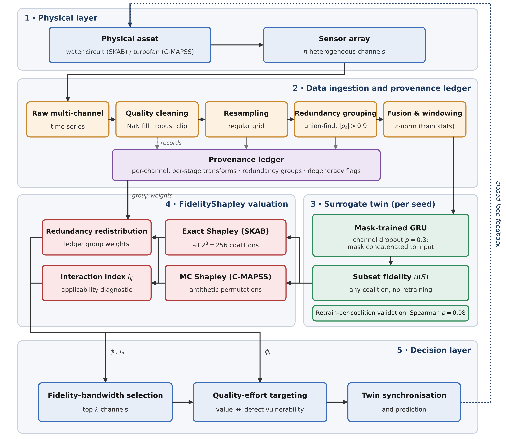

# FidelityShapley

**Provenance-aware, fidelity-anchored valuation of sensor data for digital-twin synchronisation.**

Reference implementation, configuration and experimental evidence for:

> G. Alam, *FidelityShapley: Provenance-Aware, Fidelity-Anchored Valuation of Sensor Data for
> Digital-Twin Synchronisation*, **Digital Twin** (Taylor & Francis), submitted 2026.

[](https://github.com/gulzara3/fidelity-shapley/actions/workflows/ci.yml)


A digital twin is only as faithful as the sensor streams that synchronise it.
FidelityShapley assigns every sensor channel the Shapley value of a cooperative
game whose utility is the twin's **fidelity against held-out physical telemetry**.
A single surrogate trained with stochastic channel masking evaluates any channel
coalition without retraining, and a provenance ledger records every pipeline
transformation and the redundant channel groups among which value is redistributed.

<p align="center"></p>

---

## Key results (5 seeds)

| Claim | Result | Evidence |
|---|---|---|
| Mask-trained utility agrees with retraining (SKAB) | Spearman ρ = 0.979, Pearson r = 0.994 (12 pairs) | `results/scores/spotcheck.json` |
| Blind recovery of uninformative C-MAPSS sensors | AUROC = 1.000 ± 0.000; incl. near-constant **s6**, missed by variance screening | `results/paper_numbers_dt_final.json` → `h1` |
| Closed-loop selection, C-MAPSS, k = 8 | RUL RMSE 14.97 ± 0.21 vs 15.14–15.52 (mRMR, VoI, variance, MI) | `results/scores/bandwidth.json` |
| Near-full fidelity (5 % band), C-MAPSS | k\* = 12 channels vs 16 for MI / VoI proxy / random | `bandwidth_summary.cmapss.kstar` |
| Where valuation does not pay (SKAB) | MI reaches the band at k\* = 3 vs 5 | `bandwidth_summary.skab.kstar` |
| Applicability diagnostic | Ī_rel ≈ 0.80 on both twins; what matters is whether φ and Δ rankings diverge | `results/scores/interactions.json` |
| Merging a redundant pair | merged value 27 % below the members' sum in all 5 seeds | `results/scores/merged.json` |
| Value ↔ defect vulnerability | Spearman ρ = 0.69 (n = 8) | `results/scores/defect_map_v2.json` |

Every number above is re-derived from the archived files by `python -m pytest tests/test_evidence.py`.

---

## Repository layout

```
fidelity-shapley/
├── src/fidelity_shapley/          # the package
│   ├── config.py                  # every hyper-parameter (defaults = paper run)
│   ├── experiment.py              # resumable end-to-end runner (Algorithm 1)
│   ├── cli.py                     # `fidelity-shapley run | verify | figures | info`
│   ├── data/                      # download (SKAB, C-MAPSS) + provenance pipeline & ledger
│   ├── models/                    # mask-trained GRU surrogate, coalition utility u(S)
│   ├── valuation/                 # exact & antithetic MC Shapley, merged game, interactions
│   ├── evaluation/                # H1 sensors, bandwidth & tests, defects, spot-check,
│   │                              # inferability, detection
│   ├── reporting/paper_figures.py # Figs. 2–6 exactly as published
│   └── verify.py                  # compares a run with the archived evidence
├── configs/                       # paper.yaml (published run), smoke.yaml (quick CPU check)
├── results/                       # ARCHIVED EXPERIMENTAL EVIDENCE (see results/README.md)
├── notebooks/                     # original Colab notebook used for the paper run
├── scripts/                       # run_paper.sh, reproduce_from_checkpoints.sh, make_figures.py
├── tests/                         # unit tests + evidence tests (CI, CPU-only)
└── docs/                          # paper↔code map, reproducibility notes, Fig. 1 (draw.io)
```

## Installation

```bash
git clone https://github.com/gulzara3/fidelity-shapley.git
cd fidelity-shapley
python -m venv .venv && source .venv/bin/activate      # Windows: .venv\Scripts\activate
pip install -e ".[dev]"
```

PyTorch ≥ 2.1 is required. For a CUDA build follow <https://pytorch.org/get-started/locally/>;
the CPU build is sufficient for everything except a full retraining.

## Reproducing the paper

There are four levels, from seconds to hours:

| Level | Command | Time | What it shows |
|---|---|---|---|
| 1. Evidence | `python -m pytest tests/test_evidence.py -v` | seconds | every headline number follows from `results/` |
| 2. Figures | `fidelity-shapley figures` | ~1 min | Figs. 2–6 regenerated from `results/` |
| 3. Recompute from checkpoints | `bash scripts/reproduce_from_checkpoints.sh outputs/repro` | ~10–30 min on CPU | downloads the data, reuses the 10 archived surrogates, recomputes **all** valuation, evaluation and validation stages, and writes `outputs/repro/reproduction_report.md` |
| 4. Full run from scratch | `bash scripts/run_paper.sh` | ~2–2.5 h on an NVIDIA L4 | retrains every surrogate (resumable) |

A quick installation check on CPU (a few minutes; numbers not comparable to the paper):
`fidelity-shapley run --config configs/smoke.yaml`.

Level 3 has been executed for this release; its report is archived as
[`results/reproduction_report_cpu.md`](results/reproduction_report_cpu.md).

### Running individual stages

```bash
fidelity-shapley run --stages shapley,bandwidth          # dependencies are added automatically
fidelity-shapley run --seeds 0,1 --device cpu            # subset of seeds
fidelity-shapley info                                    # resolved configuration
```

Stages: `download, prepare, train, shapley, merged, defects, spotcheck, evaluate,
bandwidth, interactions, inferability, export`. Each writes per-seed keyed JSON
under `--exp-dir` and is skipped when already complete, so interrupted runs resume.

## Data

Both benchmarks are public and are downloaded automatically; they are **not**
redistributed in this repository.

* **SKAB** — Skoltech Anomaly Benchmark (I. D. Katser, V. O. Kozitsin, 2020),
  DOI [10.34740/KAGGLE/DSV/1693952](https://doi.org/10.34740/KAGGLE/DSV/1693952);
  files from <https://github.com/waico/SKAB> (GPL-3.0).
* **C-MAPSS FD001** — NASA turbofan engine degradation simulation
  (A. Saxena et al., PHM 2008); public mirror configured in `configs/paper.yaml`.

Content fingerprints of the files used for the paper run are in
`results/data/checksums.json`.

## Reproducibility notes

See [`docs/reproducibility.md`](docs/reproducibility.md) for determinism, hardware,
tolerances and one platform-dependence fix (constant-sensor normalisation), and
[`docs/methodology.md`](docs/methodology.md) for the exact mapping between the
paper's equations and the code.

## Citation

```bibtex
@article{alam2026fidelityshapley,
  author  = {Alam, Gulzar},
  title   = {FidelityShapley: Provenance-Aware, Fidelity-Anchored Valuation of Sensor Data
             for Digital-Twin Synchronisation},
  journal = {Digital Twin},
  year    = {2026},
  note    = {Submitted}
}
```

## Licence

Code: MIT (see `LICENSE`). Datasets remain under their original terms.

## Contact

Gulzar Alam, Ulster University·
g.alam@ulster.ac.uk
